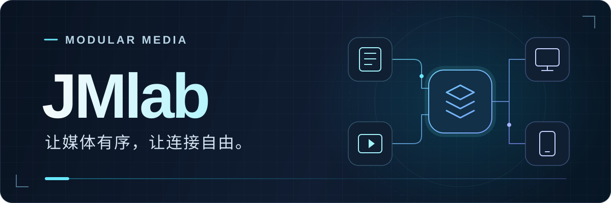
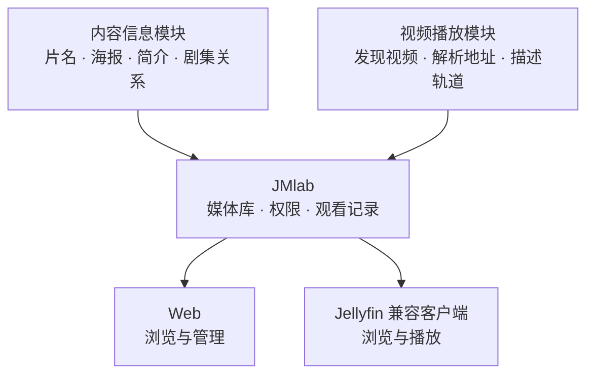

<a name="readme-top"></a>

<div align="center">



# JMlab · 你的媒体，自由连接

**按需连接模块，把电影、剧集和个人视频整理成自己的媒体库。**

一个管理入口，多种内容服务。电脑、手机与电视，按你的方式观看。

[](https://hub.docker.com/r/graysui/jmlab)
[](https://github.com/graysui/JMlab/actions/workflows/docker-publish.yml)
[](docs/module-developer-guide.md)
[](docs/jellyfin-compatibility.md)

[快速部署](#docker-部署) · [开始使用](#开始使用) · [客户端连接](#第三方客户端怎么用)
<br/>
[开发模块](#开发自己的模块) · [使用文档](#使用文档)

[](https://t.me/JMlab7)

</div>

---

## 从内容到观看，连接起来

JMlab 是一个**以模块为核心的媒体管理服务**。你可以把它理解成媒体库的「搭建底座」：模块提供内容信息与视频资源，JMlab 负责整理、管理权限和保存观看记录，你通过 Web 或兼容客户端浏览与播放。

不限定某个内容网站，也不限定一种使用方式。想整理个人视频、搭建家庭影音库，或接入自己的内容服务，都可以从所需模块开始。

| 你想做什么 | 从这里开始 |
| --- | --- |
| **先了解它能做什么** | 看[核心能力](#围绕模块组织你的媒体库)，了解模块与媒体库如何配合。 |
| **搭建自己的媒体库** | 按 [Docker 部署](#docker-部署)启动，再跟随[使用流程](#开始使用)完成配置。 |
| **用熟悉的播放器观看** | 查看[客户端连接方式](#第三方客户端怎么用)与兼容范围。 |
| **开发或接入新的服务** | 从 [HTTP / JSON 模块接口](#开发自己的模块)或 [AI 开发 Skill](#用-ai-协助开发模块)开始。 |

> [!IMPORTANT]
> **JMlab 提供主程序，不附带内容或具体模块。** 全新安装没有预置模块和虚拟媒体库；需要自行准备模块，并按提供者说明独立运行。设备能否播放，取决于模块能力、媒体格式和客户端支持。

## 围绕模块组织你的媒体库

### 自由组合，统一管理

| 能力 | 带来的体验 |
| --- | --- |
| **模块化扩展** | 内容信息、视频播放或两者兼具的复合模块，按需要组合，不必更换整套管理方式。 |
| **无需重启的配置更新** | 导入清单、修改配置、启停和更换模块连接，无需重启主程序。模块程序本身仍需独立维护。 |
| **按喜好整理媒体库** | 使用模块提供的模板与榜单范围，按条件组织已入库内容，不用复制视频文件来分库。 |
| **多个视频模块协作** | 为各个视频模块选择适用媒体库，独立配置，让不同服务各司其职。 |
| **每个人都有自己的记录** | 账号、媒体库权限、收藏、已看与续播状态统一管理，观看进度按用户保存。 |
| **Web 与客户端共用** | 同一套媒体目录、权限和观看记录；Web 负责配置管理，兼容客户端负责日常浏览与播放。 |

### 一眼看懂它如何工作



使用远程视频模块时，视频可以保留在所连接的服务中，按需读取或经 JMlab 中继，**不必先在服务器上保存整部视频**。主程序仍需磁盘空间保存数据库、配置、媒体信息与缓存。

JMlab 还提供剧集层级、合集、个人清单与备份恢复。停用或卸载模块后，已添加的媒体和观看记录仍会保留。

## Docker 部署

**一个 Compose 文件，填写两个设置，即可启动主程序。** 默认使用 SQLite，无需单独安装数据库或准备 `.env`。

以下示例固定使用 **`graysui/jmlab:v1.0.1`**，适用于 **Linux AMD64（x86_64）**。从此版本起，镜像自带运行默认值与健康检查，程序自动生成并持久保存系统密钥。

### 1 · 保存部署文件

新建一个目录，在其中创建 `compose.yaml`，复制以下内容，也可使用仓库中的 [Compose 文件](deploy/docker-compose.release.yml)：

```yaml
services:
  jmlab:
    image: graysui/jmlab:v1.0.1
    restart: unless-stopped
    ports:
      - "8097:8097"
    environment:
      JMLAB_PUBLIC_URL: "http://你的服务器IP:8097"
      JMLAB_BOOTSTRAP_ADMIN_PASSWORD: "填写你自己的密码"
    volumes:
      - jmlab-data:/data
      - jmlab-backup:/backup

volumes:
  jmlab-data:
  jmlab-backup:
```

### 2 · 填写地址和密码

- **访问地址**：将 `JMLAB_PUBLIC_URL` 改成实际服务器 IP 或 HTTPS 域名。
- **管理员密码**：最低 6 位英文、数字或符号，建议使用更长的独立密码。密码中的 `$` 写成 `$$`。

需要更换端口时，同时修改 `ports` 左侧的 `8097` 和访问地址中的端口。

### 3 · 启动并登录

在 `compose.yaml` 所在目录执行：

```sh
docker compose up -d
```

浏览器打开你填写的访问地址，使用 **`admin`** 和刚设置的密码登录，再继续下方的[使用流程](#开始使用)。

首次密码只用于创建账号，修改 Compose **不会重置已有账号密码**。账号创建成功后，可以移除初始化密码这一行。

> [!WARNING]
> **更新时保留数据卷和原密钥。** 不要执行 `docker compose down -v`，它会删除持久化卷。旧版 `.env` 部署升级前，先阅读[密钥迁移步骤](docs/release-install.md#从旧版-env-部署迁移)，不要用新密钥替换原密钥。

<details>
<summary><strong>进阶：数据保存、版本更新与系统密钥</strong></summary>

数据库、模块配置与密钥保存在 `jmlab-data` 卷；`jmlab-backup` 卷用于保存页面配置的本地备份。重建容器会复用原卷，迁移时需要同时保留数据和对应密钥。

更新前先保存数据备份与原密钥，修改 Compose 的 `image`，然后在**原部署目录**执行：

```sh
docker compose pull
docker compose up -d
```

网络连接、备份迁移、数据库选项与更新细节见[完整部署说明](docs/release-install.md)。

</details>

## 开始使用

### 1 · 准备模块

启动 JMlab 并用管理员账号登录。选择所需模块，按照模块提供者的说明启动服务，准备它的 `manifest.json` 清单。

### 2 · 导入并配置

打开 **模块管理 → 添加模块**，导入清单、确认服务地址并填写所需凭证。保存时会检查连接，成功后即可使用。

模块的配置与操作集中在 **功能设置**；运行状态、更新清单和卸载位于 **状态与维护**。

### 3 · 添加内容

进入 **设置 → 添加内容**，选择信息模块，搜索并添加电影或剧集。剧集可以继续添加季与单集，内容信息保存在主程序中。

### 4 · 整理媒体库

打开 **设置 → 媒体库配置 → 新建媒体库**，依次选择：

**模块 → 预设模板 → 榜单范围（如有）→ 保存**

模板用于筛选已入库内容，可调整名称、排序与筛选条件。模块支持榜单时，也可以在模块页面设置同步和自动更新。

### 5 · 连接视频，开始观看

在视频模块的 **功能设置 → 适用媒体库** 中选择服务范围，再从 Web 或兼容客户端访问有权限的内容。多个视频模块可独立设置、分别服务不同媒体库。

<details>
<summary><strong>日常操作速查：设置在哪里？</strong></summary>

| 想做什么 | 在哪里操作 |
| --- | --- |
| 添加模块 | 模块管理 → 添加模块 |
| 修改连接、凭证或模块功能 | 模块管理 → 对应模块 → 功能设置 |
| 配置榜单同步 | 对应模块 → 榜单与自动更新（需模块声明支持） |
| 调整视频模块的适用范围 | 对应模块 → 功能设置 → 适用媒体库 |
| 更新模块清单或卸载 | 对应模块 → 状态与维护 |
| 管理媒体库、用户或备份 | 设置 → 对应功能 |

热加载作用于主程序中的模块连接与配置。模块服务的启动与程序升级仍由用户或模块维护者负责，导入清单不会自动启动模块进程。

</details>

## 第三方客户端怎么用

完成 Web 初始化后，日常观看可以主要使用兼容客户端，**无需额外部署一套 Jellyfin 服务端**。

1. 在 Web 中配置模块、添加内容、创建媒体库，并为用户分配权限。
2. 在支持 **Jellyfin 服务端连接**的客户端中，填写 JMlab 的访问地址与账号。同时支持 Emby / Jellyfin 的应用，请选择 **Jellyfin** 连接方式。
3. 登录后浏览和播放，观看进度、收藏与已看状态由 JMlab 保存。调整模块或媒体库时，再进入 Web 管理。

> [!NOTE]
> **兼容接口不等于所有客户端、所有格式都能播放。** JMlab 当前不提供服务端转码，客户端需支持实际媒体格式。仅支持 Emby 协议的应用，以及未实测的设备和客户端版本，需要单独验证。详见 [Jellyfin 兼容说明](docs/jellyfin-compatibility.md)。

## 开发自己的模块

用你熟悉的语言，通过 **HTTP / JSON** 接入。第三方模块使用相同的公开接口，无需修改主程序或为每个模块单独编写管理页面。

| 模块类型 | 负责的能力 |
| --- | --- |
| `metadata` · 内容信息 | 搜索、媒体详情、实体关系、图片与榜单。 |
| `stream` · 视频播放 | 视频候选发现、媒体地址解析、可用性探测及轨道描述。 |
| `composite` · 复合模块 | 同时提供内容信息与视频能力。 |

接入分为四步：

1. **声明能力**：在 `manifest.json` 中描述模块身份、服务地址、媒体类型与配置字段。
2. **实现接口**：实现能力检查，以及所需的搜索、详情或媒体流接口。
3. **声明交互**：按需提供管理操作、虚拟库模板与榜单，由主程序生成相应界面。
4. **按权限协作**：使用模块专属存储、跨模块调用与事件通知，不直接访问宿主业务表。

配置与私有存储按模块身份管理；接入模块不会为用户增加额外的媒体访问权限。详见[模块开发指南](docs/module-developer-guide.md)与 [API 参考](docs/openapi.yaml)。

### 用 AI 协助开发模块

仓库提供 **[JMlab 模块开发 Skill](skills/jmlab-module-development/SKILL.md)**，可交给支持 `SKILL.md` 的 AI 开发工具，辅助核对目标版本接口、编写模块和完成本地检查。

下载整个 `skills/jmlab-module-development/` 文件夹，放入 AI 工具的 Skill 目录。Codex 可放在 `~/.codex/skills/jmlab-module-development/`；保留 `references/` 和 `agents/`，不要只复制入口文件。

在能识别该 Skill 的会话中，说明目标版本、上游接口与需求，例如：

```text
请使用 $jmlab-module-development 开发一个 Python 复合模块。
目标宿主版本以我提供的 JMlab 源码为准，上游接口说明见所附文档。
需要电影搜索和详情、热门榜单、虚拟库模板、视频解析与中文字幕。
账号和连接检查放在模块设置中，视频通过 JMlab 对接 Jellyfin 客户端。
请完成清单、独立服务、使用说明和本地测试，缺少真实账号的部分标明待验证。
```

<details>
<summary><strong>展开 Skill 配套参考资料</strong></summary>

| 资料 | 内容 |
| --- | --- |
| [Skill 入口](skills/jmlab-module-development/SKILL.md) | 能力选择、开发流程、版本核对与模块边界。 |
| [清单与信息模块](skills/jmlab-module-development/references/manifest-and-metadata.md) | 清单、配置表单、管理操作、媒体标识、榜单与模板。 |
| [播放与宿主协作](skills/jmlab-module-development/references/playback-and-host.md) | 视频解析、轨道字幕、Jellyfin、存储回调、模块调用与事件。 |
| [本地验收与交付](skills/jmlab-module-development/references/verification.md) | 安装、热切换、权限、播放链路与交付检查。 |

</details>

Skill 提供开发指导，不会自动提供内容或视频，也不随主程序镜像加载。具体模块仍需根据上游服务实现，并在真实环境中验证。

## 使用文档

| 我想了解… | 阅读 |
| --- | --- |
| 部署、数据保存、备份与更新 | [部署说明](docs/release-install.md) |
| 模块安装、管理、模板与开放接口 | [模块使用与开发指南](docs/module-developer-guide.md) |
| 客户端连接、支持能力与播放边界 | [Jellyfin 兼容说明](docs/jellyfin-compatibility.md) |
| 主程序与模块管理接口字段 | [API 参考](docs/openapi.yaml) |

---

<div align="center">

**JMlab · 让媒体有序，让连接自由。**

[开始部署](#docker-部署) · [探索模块开发](#开发自己的模块) · [返回顶部](#readme-top)

</div>
