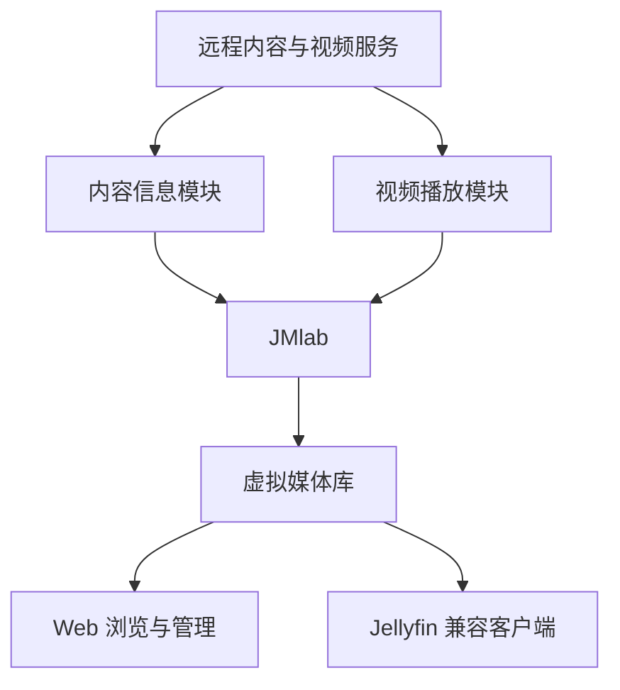

<div align="center">

# JMlab

**按需连接模块，构建自己的媒体库。**

虚拟媒体管理 · 模块热加载 · Jellyfin 兼容接口

[](https://hub.docker.com/r/graysui/jmlab)

[Docker 部署](#docker-部署) · [使用流程](#开始使用) · [模块开发](#开发自己的模块) · [模块指南](docs/module-developer-guide.md)

</div>

---

JMlab 是一个以模块为核心的虚拟媒体管理服务，适用于电影、剧集和个人视频。你可以组合不同模块提供内容信息与视频资源，在统一界面中整理媒体库、管理访问权限和保存观看记录。

**主程序提供统一的管理体验，模块负责扩展具体能力。** 多个模块可以同时使用，每个模块都有自己的设置页面，可按需安装、配置、启用或停用。

## 用模块搭建自己的「影视壳」

你可以把 JMlab 理解成一个可扩展的媒体服务底座：**模块提供内容目录和可播放地址，JMlab 把它们组织成媒体库，客户端负责浏览与播放。** 配好相应模块后，可以获得接近 Emby / Jellyfin 媒体库的使用体验，而不必先在服务器上收集和保存完整视频文件。

| 想达到的效果 | 模块与底座如何配合 |
| --- | --- |
| 🎬 在线影视库 | 信息模块提供片名、海报、简介及剧集关系；视频模块按需提供可播放地址。 |
| ☁️ 服务器不存视频 | 视频保留在模块对接的远程服务中，播放时获取地址，由客户端读取或经主程序中继，无需先下载整部视频。 |
| 📺 日常只用客户端 | 用 Web 完成初始化和模块配置后，可以主要通过兼容客户端浏览媒体库、选择内容和播放，无需再部署一套 Jellyfin 服务端。 |
| 🗂️ 按喜好整理入口 | 模块提供榜单与预设模板，用户创建自己的虚拟库，不需要复制视频文件来分库。 |
| 👥 多用户共用 | 主程序统一管理账号、媒体库权限、收藏、已看与续播记录；不同用户各自保留观看状态。 |
| 🔧 按需求扩展 | 通过公开接口开发或接入模块，替换内容信息与视频服务，保留统一的媒体管理和客户端入口。 |

例如，可以开发或接入一组「影视信息模块 + 远程视频模块」，把远程内容整理成电影、剧集和单集，再在电视、手机或电脑上的兼容客户端中观看。也可以让多个视频模块分别服务不同媒体库，组合成自己的内容入口。

**无需本地保存视频，不代表完全不需要磁盘。** 主程序仍需持久化数据库、账号、模块配置、媒体信息、观看记录和缓存；是否支持某个内容服务、是否能播放某种格式，取决于模块能力与客户端解码支持。镜像本身不附带内容目录或视频服务。

### 第三方客户端怎么用

1. 在 Web 中配置模块、添加内容、创建媒体库，并为用户分配权限。
2. 在支持连接 **Jellyfin 服务端**的第三方客户端中，填入 JMlab 的访问地址和账号；同时支持 Emby / Jellyfin 的客户端请选择 **Jellyfin** 连接方式。
3. 登录后直接在客户端浏览和播放，观看进度、收藏和已看状态由 JMlab 保存。后续调整模块与媒体库时，再进入 Web 管理。

JMlab 提供 Jellyfin 兼容接口；仅支持 Emby 协议的客户端需要另外适配与实测。当前支持范围、媒体直放与中继说明见[客户端兼容说明](docs/jellyfin-compatibility.md)。

## 围绕模块组织你的媒体库



| 能力 | 使用体验 |
| --- | --- |
| 🧩 按需扩展 | 自行选择信息模块、视频模块或同时具备两种能力的复合模块，组合所需功能。 |
| ⚡ 热加载管理 | 导入清单、修改配置、启停和更换模块连接即时生效，无需重启主程序。 |
| 🎛️ 模块内设置 | 连接凭证、功能操作和榜单更新集中在相关模块页面，设置项由模块声明。 |
| 📚 虚拟库模板 | 新建媒体库时先选模块，再选择它提供的模板和榜单范围，按需调整筛选条件。 |
| 🎯 多模块分工 | 为视频模块指定适用媒体库，让不同模块分别服务于不同内容。 |
| 🔗 统一访问 | Web 与兼容客户端共用媒体目录、权限和观看记录，模块提供的能力接入同一播放链路。 |

主程序同时提供媒体浏览、剧集层级、合集、个人清单、收藏、已看状态、续播和备份恢复。模块停用或卸载后，已添加的媒体与观看记录仍会保留。

> 本仓库与 Docker 镜像只提供主程序，具体模块由用户自行准备并独立运行。全新安装没有预置模块，也不会自动创建虚拟媒体库。

## Docker 部署

使用 Docker Compose 直接拉取镜像，本次发布支持 **Linux AMD64（x86_64）**，无需下载源码或本地编译。

| 镜像 | 用途 |
| --- | --- |
| `graysui/jmlab:v1.0.0` | 固定版本，推荐用于日常部署。 |
| `graysui/jmlab:latest` | 最新正式版，需要手动拉取后更新。 |

### 1 · 下载部署文件

以下命令用于全新安装，请在新的目录中执行：

```sh
mkdir jmlab && cd jmlab
curl -fSL https://raw.githubusercontent.com/graysui/JMlab/v1.0.0/deploy/docker-compose.release.yml -o compose.yaml
curl -fSL https://raw.githubusercontent.com/graysui/JMlab/v1.0.0/deploy/release.env.example -o .env
chmod 600 .env
```

### 2 · 设置账号与密钥

用文本编辑器打开 `.env`，修改以下配置：

| 配置 | 填写方式 |
| --- | --- |
| `JMLAB_PUBLIC_URL` | 实际访问地址，例如 `http://服务器IP:8097`；配置域名后填写 HTTPS 地址。 |
| `JMLAB_MASTER_KEY` | 运行 `openssl rand -hex 32` 生成，保存好这个值，升级时继续使用。 |
| `JMLAB_SESSION_SECRET` | 再运行一次 `openssl rand -hex 32`，使用另一份随机值。 |
| `JMLAB_BOOTSTRAP_ADMIN_USERNAME` | 首次登录用户名，默认 `admin`。 |
| `JMLAB_BOOTSTRAP_ADMIN_PASSWORD` | 自行设置强密码，建议至少 12 位。 |

### 3 · 启动并登录

```sh
docker compose pull
docker compose up -d
docker compose ps
```

浏览器打开 **`http://服务器IP:8097`**，使用刚才设置的管理员账号登录，然后按下面的流程添加模块。

数据保存在 Docker 命名卷中，重建容器会继续使用。升级前先在页面备份并保存 `.env`，修改其中的镜像版本，再执行 `docker compose pull && docker compose up -d`。**不要执行 `docker compose down -v`，它会删除数据卷。**

更多配置、模块网络连接与升级步骤见[完整部署说明](docs/release-install.md)。

## 开始使用

### 1 · 准备主程序与模块

按上面的 [Docker 部署](#docker-部署)启动 JMlab，并使用管理员账号登录。选择需要的模块，按照模块提供者的说明启动服务，准备好它提供的 `manifest.json` 清单。

### 2 · 导入并设置模块

打开 **模块管理 → 添加模块**，导入清单，确认服务地址并填写所需凭证。保存时会检查连接，成功后即可使用。

在模块的 **功能设置** 页面管理其配置和操作；在 **状态与维护** 中查看运行状态、更新清单或卸载模块。

### 3 · 搜索并添加内容

进入 **设置 → 添加内容**，选择信息模块，搜索并添加电影或剧集。剧集可以继续添加季与单集，已添加的内容保存在主程序中。

### 4 · 创建自己的虚拟媒体库

打开 **设置 → 媒体库配置 → 新建媒体库**，依次选择：

**模块 → 预设模板 → 榜单范围（如有）→ 保存**

模板由所选模块提供，用于筛选已入库内容。你可以调整名称、排序和筛选条件；模块声明榜单能力时，也可在模块页面设置同步与自动更新。

### 5 · 配置视频与开始观看

在视频模块的 **功能设置 → 适用媒体库** 中选择服务范围，再从 Web 或兼容客户端访问有权限的内容。多个视频模块可分别配置，各自保留独立设置。

兼容客户端支持范围与播放限制见 [Jellyfin 兼容说明](docs/jellyfin-compatibility.md)。

## 日常管理

| 想做什么 | 在哪里操作 |
| --- | --- |
| 添加模块 | 模块管理 → 添加模块 |
| 修改连接、凭证或模块功能 | 模块管理 → 对应模块 → 功能设置 |
| 配置榜单同步 | 对应模块 → 榜单与自动更新（需模块声明支持） |
| 调整视频模块的适用范围 | 对应模块 → 功能设置 → 适用媒体库 |
| 更新模块清单或卸载 | 对应模块 → 状态与维护 |
| 管理虚拟库、用户或备份 | 设置 → 对应功能 |

热加载作用于主程序中的模块连接与配置。**模块服务的启动和程序升级仍由用户或模块维护者负责**，JMlab 不会自动启动模块进程。

## 开发自己的模块

模块通过开放的 **HTTP / JSON 接口**接入，可以使用熟悉的语言独立实现。第三方模块使用相同的清单和接口，无需修改主程序即可接入管理页面与媒体链路。

| 模块类型 | 负责的能力 |
| --- | --- |
| `metadata` · 内容信息 | 搜索、媒体详情、实体关系、图片与榜单。 |
| `stream` · 视频播放 | 视频候选发现、媒体地址解析、可用性探测及媒体轨道描述。 |
| `composite` · 复合模块 | 同时提供内容信息与视频能力。 |

一个模块的接入过程：

1. **声明能力**：编写 `manifest.json`，说明模块身份、服务地址、支持的媒体类型和配置字段。
2. **实现接口**：提供能力检查接口，并根据模块类型实现搜索、详情或媒体流相关接口。
3. **扩展交互**：按需声明管理操作、虚拟库模板、榜单和更新范围，由主程序生成相应界面。
4. **连接宿主**：按权限使用模块专属存储、跨模块调用和事件通知，与其他能力协作。

模块配置和私有存储由宿主按模块身份管理；模块接入不会授予用户额外的媒体访问权限。

→ 查看[完整模块开发指南](docs/module-developer-guide.md)，了解清单格式、接口契约、热加载、认证与 Jellyfin 播放对接。

## 使用文档

| 文档 | 内容 |
| --- | --- |
| [部署说明](docs/release-install.md) | 主程序部署、持久化目录与运行配置。 |
| [模块使用与开发指南](docs/module-developer-guide.md) | 模块安装、管理、模板与开放接口。 |
| [Jellyfin 兼容说明](docs/jellyfin-compatibility.md) | 客户端接入能力及播放边界。 |
| [API 参考](docs/openapi.yaml) | 主程序与模块管理接口字段。 |
